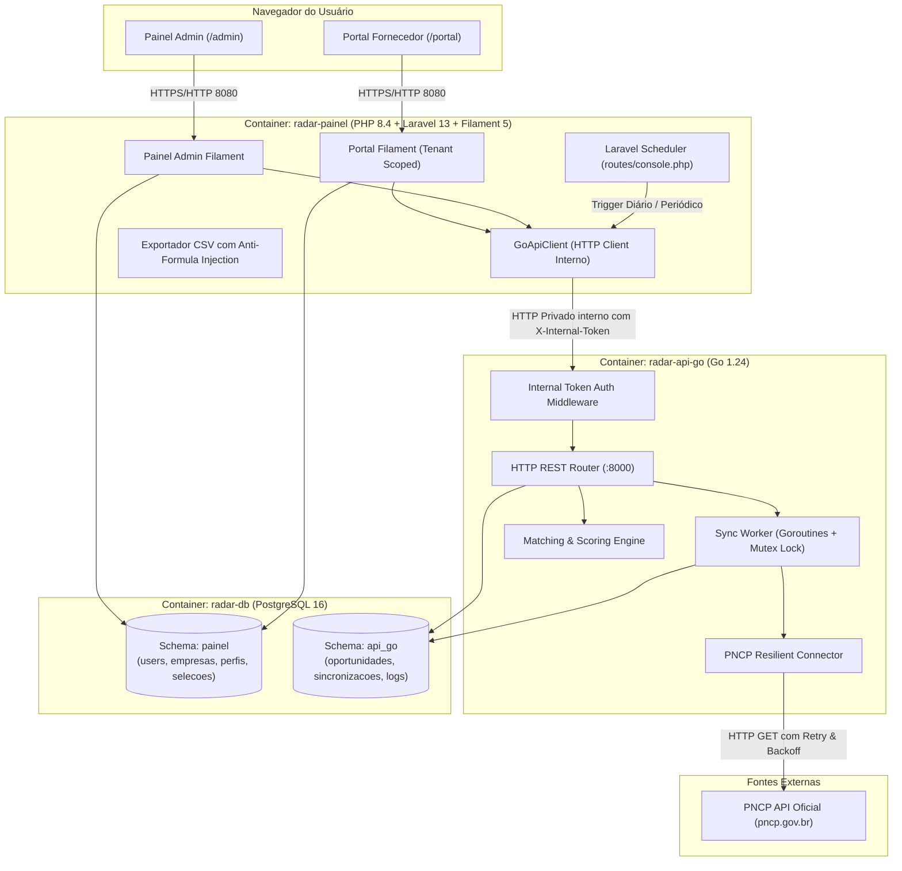
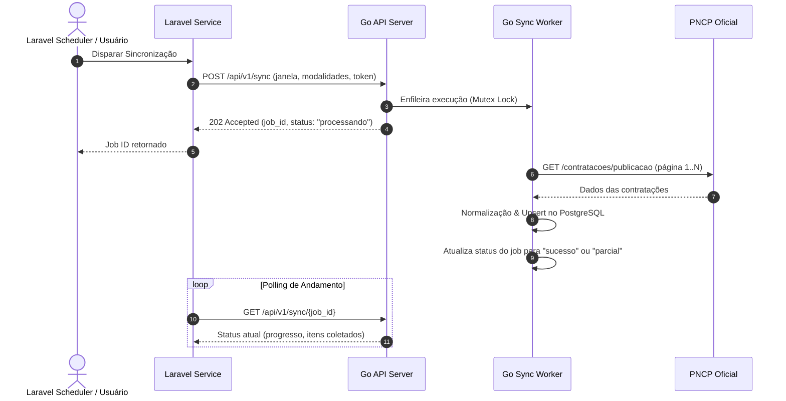

# Arquitetura — Radar de Compras Públicas

> **Especificação Técnica da Arquitetura Dual Go + Laravel Filament**  
> Fuso horário da aplicação: `America/Sao_Paulo`

---

## 1. Visão Arquitetural

O **Radar de Compras Públicas** opera com uma arquitetura desacoplada e complementar:

---

## 2. Separação de Responsabilidades e Schemas de Dados

Para assegurar independência de ciclo de vida e evitar acoplamento direto de banco:

1. **Instância Única de PostgreSQL (`radar-db`):**
   - Criação dos schemas lógicos: `painel` e `api_go`.
2. **Schema `painel` (Gerenciado pelo Laravel Migrations):**
   - `empresas`: Cadastro da pessoa jurídica (nome fantasia, razão social, CNPJ, status).
   - `users`: Usuários vinculados a empresas (`role`: `admin`, `fornecedor`).
   - `fornecedor_perfis`: Configurações de busca de cada fornecedor (`empresa_id`, `nome`, `termos_obrigatorios`, `termos_excluidos`, `ufs`, `ativo`).
   - `oportunidade_selecoes`: Decisões do fornecedor (`empresa_id`, `numero_controle_pncp`, `status: em_analise|selecionada|descartada`, `observacoes`, `atualizado_por_id`).
3. **Schema `api_go` (Gerenciado pela API Go Migrations):**
   - `oportunidades`: Tabela canônica de contratações coletadas no PNCP (chave primária natural: `numero_controle_pncp`, dados do órgão, objeto, valores, datas, links oficiais, flags `is_demonstrativo`).
   - `sincronizacoes`: Histórico de execuções (`id`, `origem`, `janela_inicio`, `janela_fim`, `status: pendente|processando|sucesso|parcial|falha`, `total_itens`, `novos_itens`, `itens_atualizados`, `paginas_processadas`, `erros`, `iniciado_em`, `finalizado_em`).
   - `sincronizacao_logs`: Trilha de eventos detalhada por execução.

---

## 3. Segurança e Multi-Tenancy

1. **Contexto Forçado no Servidor:**
   - O fornecedor autenticado possui seu `empresa_id` fixado na sessão autenticada.
   - Qualquer consulta enviada ao Go passa pelo `empresa_id` validado pelo Laravel, nunca dependendo de IDs arbitrários enviados em query params ou payloads do frontend.
2. **Autenticação Interna Server-to-Server:**
   - O tráfego entre `radar-painel` e `radar-api-go` ocorre na rede interna do Docker (`radar-network`).
   - Todas as rotas privadas de Go exigem o header:
     `X-Internal-Token: ${RADAR_INTERNAL_TOKEN}`
   - Nenhum segredo é exposto em JavaScript ou HTML do cliente.
3. **Proteção Contra Injeção em Planilhas (CSV Injection):**
   - Na exportação de dados para CSV, qualquer campo textual iniciando com `=`, `+`, `-`, `@`, `\t` ou `\r` é automaticamente antecedido por apóstrofo (`'`), neutralizando execuções de comandos arbitrários no Microsoft Excel e LibreOffice Calc.

---

## 4. Conector Resiliente do PNCP

A API oficial do PNCP (`https://pncp.gov.br/api/consulta/v1/contratacoes/publicacao`) possui particularidades estritas:
1. **Parâmetros Obrigatórios:**
   - `codigoModalidadeContratacao`: Identificador numérico da modalidade (ex: `6` para Pregão Eletrônico, `8` para Dispensa de Licitação).
   - `dataInicial` e `dataFinal`: Formato `YYYYMMDD`.
   - `tamanhoPagina`: Mínimo obrigatório de 10 itens por página.
2. **Filtros Locais:**
   - A fonte não garante busca textual arbitrária ou filtro por UF consistente em todos os cenários. A API Go coleta os dados da janela e aplica a filtragem em memória/SQL de termos e localização de forma determinística.
3. **Estratégia de Retry e Resiliência:**
   - Timeout de rede de 15 segundos por requisição HTTP.
   - Até 3 tentativas por requisição com intervalo exponencial (`500ms`, `1000ms`, `2000ms`).
   - Se uma página falhar definitivamente após todas as tentativas, a execução é marcada como status `parcial`, preservando os itens já processados e os registros anteriores.
4. **Idempotência e Prevenção de Concorrência:**
   - Mutex global por fonte em Go impede que duas sincronizações concorrentes varram a mesma janela simultaneamente.
   - O campo `numeroControlePNCP` impede duplicidades através de cláusula `ON CONFLICT (numero_controle_pncp) DO UPDATE`.

---

## 5. Algoritmo de Correspondência (Matching Engine)

Para cada oportunidade e perfil do fornecedor:
1. **Verificação de UF:** Se o perfil tiver restrição de UFs, a oportunidade só é elegível se `unidade_orgao_uf` constar na lista permitida.
2. **Termos Excluídos:** Caso o objeto ou informações complementares contenham qualquer termo da lista de exclusão do perfil, a oportunidade é rejeitada (`correspondente = false`).
3. **Termos Obrigatórios/Incluídos:** Verifica se ao menos um dos termos de inclusão está presente (busca insensível a maiúsculas e acentuação).
4. **Justificativa Transparente:**
   - Em caso positivo: *"Termo obrigatório 'serviços de ti' encontrado no objeto; UF 'SP' compatível; nenhuma palavra de exclusão detectada."*
   - O fornecedor sempre sabe exatamente **por que** a oportunidade foi trazida para seu radar.

---

## 6. Fluxo de Agendamento e Execução Assíncrona

